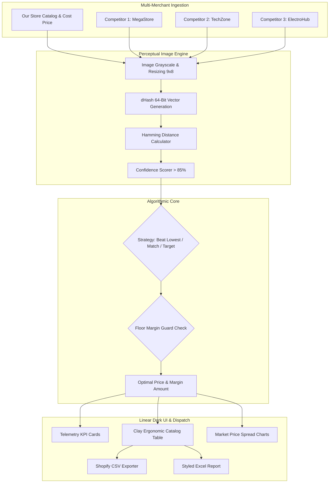

# 🏷️ OmniPrice Pro — E-Commerce Price Intelligence & Algorithmic Repricer

[](https://python.org)
[](https://streamlit.io)
[](https://plotly.com)
[](https://docker.com)
[](LICENSE)

> **Enterprise price monitoring, perceptual image matching (pHash), and dynamic algorithmic repricing terminal.**  
> Designed for high-volume merchants across **Shopify, Amazon, Rozetka, Prom.ua, and WooCommerce**. Automatically tracks competitor prices across disparate marketplaces, detects identical products using computer vision hash fingerprints, and calculates optimal margin-defending prices with automated BuyBox win-rules.

---

## 🌟 Key Capabilities

### 1. ⚡ Dynamic Repricing Strategies & Margin Guard
* **Beat Lowest Competitor by X%:** Recovers the BuyBox automatically by undercutting the lowest active merchant while maintaining positive margins.
* **Match Lowest Competitor:** Positions the store neck-and-neck with the top market offer.
* **Target Fixed Gross Margin:** Anchors pricing directly to wholesale supplier cost with a guaranteed profit markup.
* **🛡️ Loss-Prevention Floor Guard:** Hard constraint that overrides repricing when competitor price wars drop below your minimum required margin (e.g. 15%), preventing negative margin sales.

### 2. 🔍 Perceptual Visual Hash (dHash/pHash) Matcher
* Marketplaces and suppliers often rename items (e.g. *"Sony WH-1000XM5 Black"* vs *"Sony WH1000XM5/B Noise Cancelling Headset"*), breaking traditional SKU/text queries.
* OmniPrice normalizes product imagery into 64-bit difference hashes (`dHash`) using Pillow.
* Calculates bit-level **Hamming Distance** and outputs an explicit **Match Confidence Score (0–100%)** to pair identical items with zero manual data entry.

### 3. 📈 Real-Time Telemetry & Plotly Analytics
* **Interactive Spread Charts:** Multi-merchant price comparison bar chart across your store, MegaStore, TechZone, and ElectroHub.
* **Margin Distribution Matrix:** Scatter visualization showing margin percentage against competitor undercut levels.
* **Executive KPI Cards:** Monitored SKUs, Projected Average Margin %, BuyBox Dominance Rate %, and Floor Guard Trigger Counters.

### 4. 📥 One-Click Ecosystem Exports
* **Official Shopify CSV Import:** Direct compatibility with Shopify's product update schema (`Handle`, `Variant SKU`, `Variant Price`, `Variant Compare At Price`).
* **Styled Excel Workbooks (`.xlsx`):** Formatted multi-column reporting with color-coded margin statuses via `openpyxl`.

---

## 🏗️ Architecture Pipeline



---

## 🚀 Quickstart & Local Launch

### Option 1: Native Python (venv)

```bash
# Clone repository
git clone https://github.com/zymaneta-eng/omniprice-repricer.git
cd omniprice-repricer

# Create virtual environment
python -m venv .venv
source .venv/bin/activate  # On Windows: .\.venv\Scripts\activate

# Install dependencies
pip install -r requirements.txt

# Launch dashboard
streamlit run app.py --server.port 8502
```
Navigate to **`http://localhost:8502`** in your browser.

### Option 2: Docker / Docker Compose

```bash
docker compose up --build
```
Access the application on port `8502`.

---

## 📄 License
MIT License. Created by Nataliia Zyma (`Nataliia_Z2`). Available for contract engineering on Freelancehunt and Upwork.
