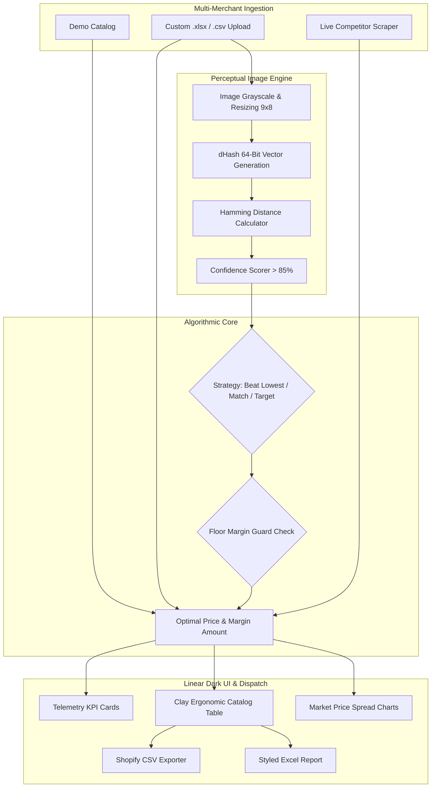

# 🏷️ OmniPrice Pro — E-Commerce Price Intelligence & Algorithmic Repricer

[](https://python.org)
[](https://streamlit.io)
[](tests/)
[](https://plotly.com)
[](https://docker.com)
[](LICENSE)

> **Enterprise price monitoring, perceptual image matching (dHash), custom catalog ingestion (.xlsx/.csv), and dynamic algorithmic repricing terminal.**  
> Designed for high-volume merchants across **Shopify, Rozetka, Prom.ua, Amazon, and WooCommerce**. Automatically tracks competitor prices across disparate marketplaces, detects identical products using computer vision hash fingerprints, and calculates optimal margin-defending prices with automated BuyBox win-rules.

---

## 👩‍💻 Hire the Developer / Контакти для замовлення

Маєте інтернет-магазин або маркетплейс і шукаєте систему динамічного ціноутворення, парсингу постачальників чи інтеграції з 1С/BAS/Shopify?

* 💬 **Прямий зв'язок у Telegram:** [@Nataly_Zyma](https://t.me/Nataly_Zyma)
* 📧 **Офіційний Email:** `areonixwinter@gmail.com`
* 🤖 **Бот технічної підтримки:** [@AreonixSupport_bot](https://t.me/AreonixSupport_bot)
* 🏢 **Виконавець:** ФОП Зима Н. М. (офіційний договір, робота з ФОП/ТОВ, безготівковий розрахунок та банківський еквайринг)

---

## 🌟 Key Capabilities

### 1. ⚡ Dynamic Repricing Strategies & Margin Guard
* **Beat Lowest Competitor by X%:** Recovers the BuyBox automatically by undercutting the lowest active merchant while maintaining positive margins.
* **Match Lowest Competitor:** Positions the store neck-and-neck with the top market offer.
* **Target Fixed Gross Margin:** Anchors pricing directly to wholesale supplier cost with a guaranteed profit markup.
* **🛡️ Loss-Prevention Floor Guard:** Hard constraint that overrides repricing when competitor price wars drop below your minimum required margin (e.g. 15%), completely preventing negative-margin sales.

### 2. 📁 Custom Catalog Upload (.xlsx / .csv) & Template Generator
* Merchants can upload their own price lists directly into the terminal.
* Supports tolerant Ukrainian and English column headers (`SKU` / `Артикул`, `Title` / `Назва`, `Cost Price` / `Собівартість`, `Our Price` / `Наша ціна`, `Competitor Min` / `Конкуренти`).
* Built-in template generator (`.xlsx`) ready for instant merchant download.

### 3. 🔍 Perceptual Visual Hash (dHash) Matcher
* Marketplaces and suppliers often rename items (e.g. *"Sony WH-1000XM5 Black"* vs *"Sony WH1000XM5/B Noise Cancelling Headset"*), breaking traditional SKU/text queries.
* OmniPrice normalizes product imagery into 64-bit difference hashes (`dHash`) using Pillow.
* Calculates bit-level **Hamming Distance** and outputs an explicit **Match Confidence Score (0–100%)** to pair identical items with zero manual data entry.

### 4. 🌐 Live Marketplace Scraper Module
* Production-ready price extractor supporting **Schema.org JSON-LD**, OpenGraph meta tags, and regex fallbacks.
* Designed for low-latency competitor monitoring with user-agent rotation and anti-bot mitigation.

### 5. 📈 Real-Time Telemetry & Plotly Analytics
* **Interactive Spread Charts:** Multi-merchant price comparison bar chart across your store, MegaStore, TechZone, and ElectroHub.
* **Margin Distribution Matrix:** Scatter visualization showing margin percentage against competitor undercut levels.
* **Executive KPI Cards:** Monitored SKUs, Projected Average Margin %, BuyBox Dominance Rate %, and Floor Guard Trigger Counters.

### 6. 📥 One-Click Ecosystem Exports
* **Official Shopify CSV Import:** Direct compatibility with Shopify's product update schema (`Handle`, `Variant SKU`, `Variant Price`, `Variant Compare At Price`).
* **Styled Excel Workbooks (`.xlsx`):** Formatted multi-column reporting with color-coded margin statuses via `openpyxl`.

---

## 🏗️ Architecture Pipeline



---

## 🚀 Quickstart & Local Launch

### Option 1: Native Python (venv)

```bash
# Clone repository
git clone https://github.com/zymaneta-eng/omniprice-repricer.git
cd omniprice-repricer

# Create virtual environment
python -m venv .venv
source .venv/bin/activate  # On Windows: .\.venv\Scripts\activate

# Install dependencies
pip install -r requirements.txt

# Run Unit Tests
pytest tests/ -v

# Launch Streamlit Terminal
streamlit run app.py
```

### Option 2: Docker / Docker Compose

```bash
docker-compose up --build
```
Open [http://localhost:8501](http://localhost:8501) in your browser.

---

## 🧪 Testing Suite

OmniPrice includes full test coverage for all repricing edge cases:
```bash
pytest tests/test_engine.py -v
```
All 8 test suites verify BuyBox undercut logic, fixed margin calculations, floor dumping guards, dHash hamming distance, template generators, and Shopify/Excel exporters.

---

## 📄 License
This project is licensed under the MIT License — see the [LICENSE](LICENSE) file for details.
